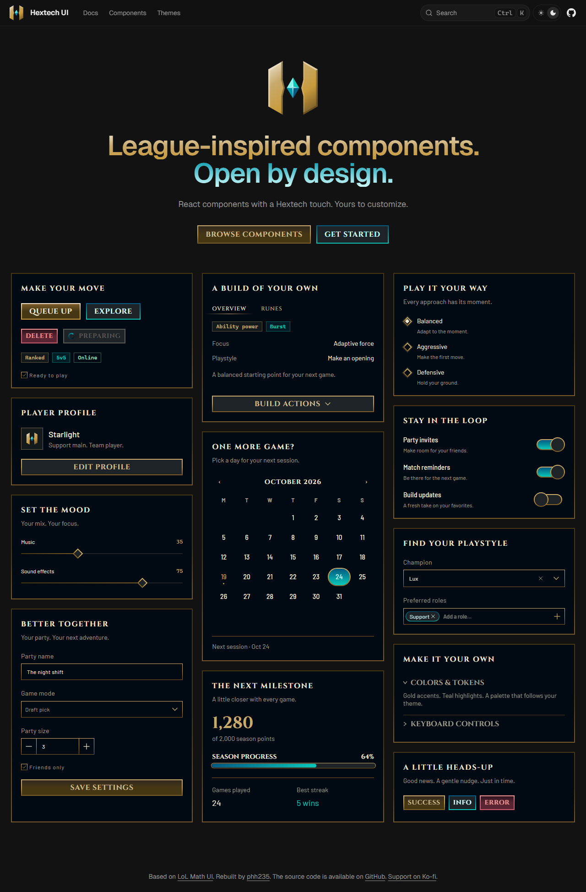

# Hextech UI

League-inspired React components you can customize, extend and make your own. Built with Base UI and Tailwind CSS. Open source. Open code.

Rebuilt for Base UI by [phh235](https://github.com/phh235), based on [LoL Math UI](https://ui.lolmath.net/). Credit for the original visual design goes to [LoL Math and its contributors](https://github.com/lolmath/lolmath/tree/main/packages/ui).

## Documentation

Visit [hextech-ui.vercel.app/docs](https://hextech-ui.vercel.app/docs) to view the documentation.

## Contributing

Please read the [contributing guide](./CONTRIBUTING.md).

## Support

If Hextech UI helps you, you can [support its development on Ko-fi](https://ko-fi.com/phh235).

## License

Hextech UI additions are licensed under [MIT](./LICENSE). Upstream materials retain their own licenses; see [third-party notices](./THIRD_PARTY_NOTICES.md).

Independent project. Not affiliated with or endorsed by Riot Games.
